<p align="right"><a href="README.zh-CN.md">简体中文</a> · <b>English</b></p>

# DocQA-lite

[](https://github.com/YHGDSa/DocQA-lite/actions/workflows/ci.yml)
[](LICENSE)

A document question-answering API with source citations and an explicit refusal path. Upload UTF-8 Markdown or plain text. DocQA-lite indexes chunks in SQLite FTS5, retrieves passages, and returns source filenames and line ranges with an answer.



## Run the offline demo

Use Python 3.12. The demo uses three sample documents and a scripted model, so it needs no API key.

```bash
git clone https://github.com/YHGDSa/DocQA-lite.git
cd DocQA-lite
python -m venv .venv
source .venv/bin/activate
python -m pip install -r requirements.txt
python scripts/demo_offline.py
```

In Windows PowerShell, create the environment with `py -3.12 -m venv .venv`, then use `.\.venv\Scripts\python.exe` in place of `python` in the last two commands.

The demo uploads documents, retrieves an annual-leave passage, answers a supported question with a citation, refuses a question without evidence, and prints the server-sent event sequence. The sample corpus and demo output are in Chinese.

## Serve the API

The service reads `LLM_BASE_URL`, `LLM_API_KEY`, and `LLM_MODEL` from process environment variables. Export these values to use an OpenAI-compatible chat endpoint, then start the service.

```bash
python -m uvicorn app.main:app --port 8001
```

| Method and path | Purpose |
|---|---|
| `GET /health` | Check service health. |
| `POST /documents/upload` | Upload multipart field `file`. Supports UTF-8 `.md` and `.txt` files up to 2 MB. Duplicate content returns the existing record. |
| `GET /documents` | List indexed documents and their chunk counts. |
| `POST /search` | Send `{"query":"…","top_k":5}` to get chunks, scores, character offsets, and line ranges. |
| `POST /ask` | Send `{"question":"…"}` to get an answer, checked citation markers, and a refusal flag. |
| `POST /ask/stream` | Send the same question to get candidate citations followed by token events and a final event. |

The retrieval gate can refuse a question before calling the model. If model configuration is missing when a model call is needed, the API returns `503`. On the streaming route, citations are retrieval candidates. Use `/ask` for final marker validation.

## Retrieval and citation behavior

- Chunks are 400 characters with 50 characters of overlap. Character offsets are zero-based with an exclusive end. Citation line ranges are one-based and inclusive.
- SQLite FTS5 uses a trigram index. Short queries and natural-language questions can fall back to parameterized `LIKE` lookup.
- `/ask` checks that bare `[n]` markers refer to retrieved chunks. A missing, malformed, or out-of-range marker produces the standard refusal. A valid marker identifies a source passage. The format check alone cannot establish that the passage supports every claim.

## Verify and evaluate

```bash
python -m pytest -q
python eval/run_eval.py
python scripts/check_eval_report.py
```

CI runs these checks and the offline demo on Ubuntu and Windows.

| Offline metric with a scripted model | Baseline | Full pipeline |
|---|---:|---:|
| Refusal decision correct | 17/30 | 22/30 |
| Correct citation for an answerable question | 0/12 | 12/12 |
| Retrieval hit for an answerable question | 0/12 | 12/12 |

The [offline report](eval/report.md) explains the comparison. The separate [12-question live-model evaluation](docs/REAL-LLM.md) recorded 4/4 correct supported answers and 8/8 correct refusals with `deepseek-chat`. With the model configured, rerun it using `python eval/run_llm_eval.py`.

## Limits

The service supports Markdown and plain text. Citation quotes use the first 200 characters of a chunk, while line ranges identify the complete chunk. The local deployment uses one SQLite database and has no pagination or quotas.

[MIT license](LICENSE)
